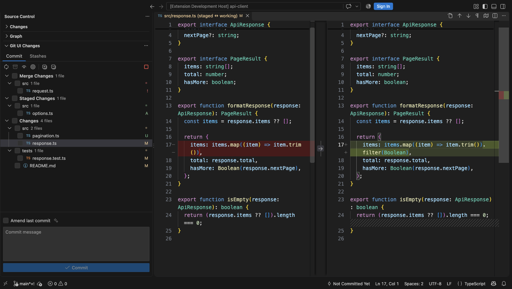
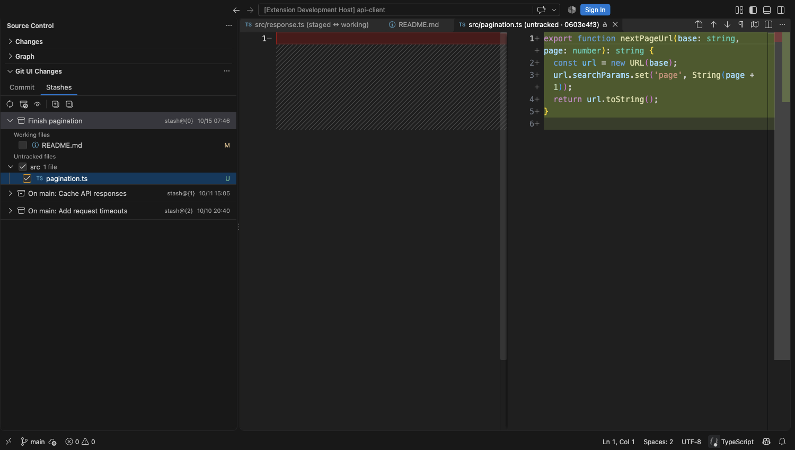
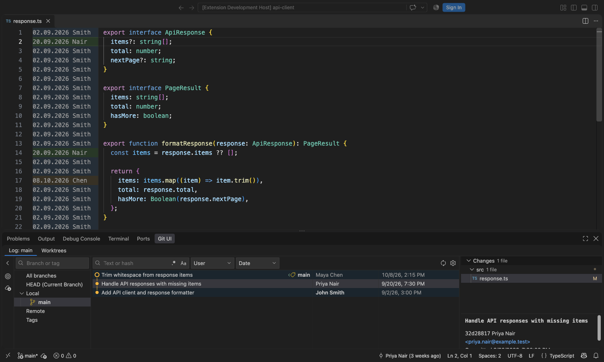
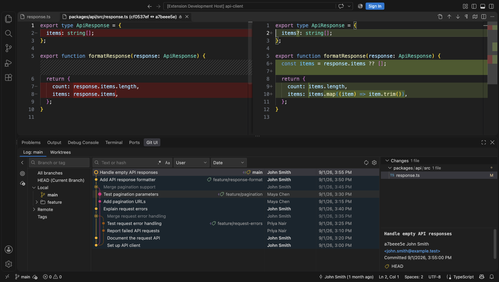
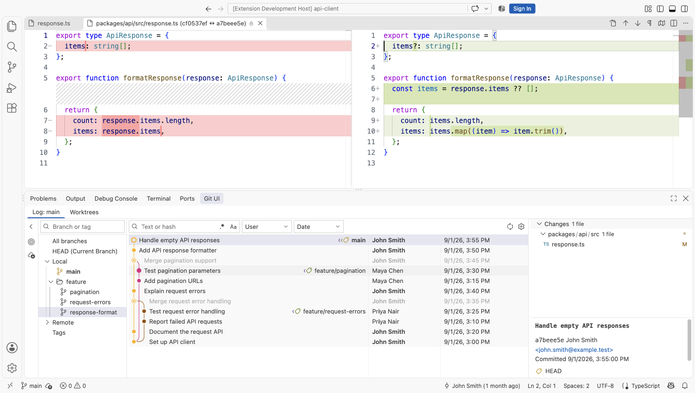

# Git UI

**Finally, a proper Git UI for VS Code. Completely free and open source. No subscriptions or paid tiers.**

Git UI helps you browse history, commit the files you choose, manage stashes, and trace code with Git Blame. It follows your VS Code theme and opens comparisons in the native diff editor.

Inspired by the Git tool window in JetBrains' [IntelliJ IDEA Community Edition](https://github.com/JetBrains/intellij-community).

## Commit the files you choose

### Keep unfinished work in stashes

## Browse history and inspect changes

## Trace a line back to its commit

Choose **Annotate with Git Blame** from the editor's line-number menu. Open a commit through the annotation's hover link or **Open Line Commit in Git UI** in the editor menu. Git UI selects the exact commit and its originating file in the Log while you keep the native editor's syntax highlighting and editing tools.

## Fits your VS Code theme

The panel follows your VS Code theme. Here it is in Dark Modern:

And in Light Modern:

## More ways to work with Git

- Create, check out, rename, delete, update, merge, or rebase branches. Restore an accidentally deleted branch from its notification.
- Cherry-pick commits, edit messages, squash, or drop eligible commits. Create a branch or tag from a commit.
- Create a worktree for another branch, open it in this window or a new one, and remove it when finished.

Branch, commit, and worktree lists support multiple selection. Use VS Code's Source Control and editors to resolve conflicts.

## Get started

Install Git UI and open a Git repository in VS Code. The **Git UI** tab in the bottom panel loads your branches and history automatically. In Source Control, expand **Git UI Changes** to find the **Commit** and **Stashes** tabs. You can hide the built-in Changes view if you prefer the checkbox workflow.

## Your repositories stay yours

Git UI has no account, cloud backend, or analytics service. Fetch connects to your configured Git remotes using VS Code's Git authentication. Optional commit message generation uses a language model configured in VS Code and sends only the checked changes to that provider when you request it. You can edit the draft before committing.

## Feedback and contributions

[Report a bug or suggest a feature](https://github.com/andreymyssak/vscode-git-ui/issues). To contribute, see [CONTRIBUTING.md](CONTRIBUTING.md).

For security vulnerabilities, follow the private reporting instructions in [SECURITY.md](SECURITY.md).

## License

Authored code is [MIT licensed](LICENSE.txt). Bundled Microsoft code and libraries retain their licenses in [THIRD_PARTY_NOTICES.md](THIRD_PARTY_NOTICES.md).
