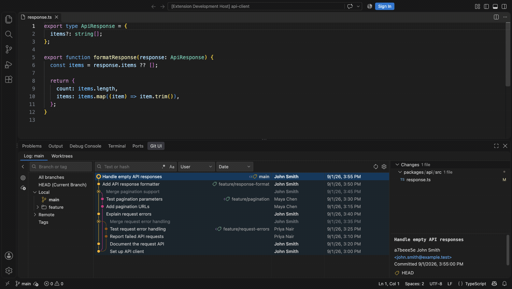
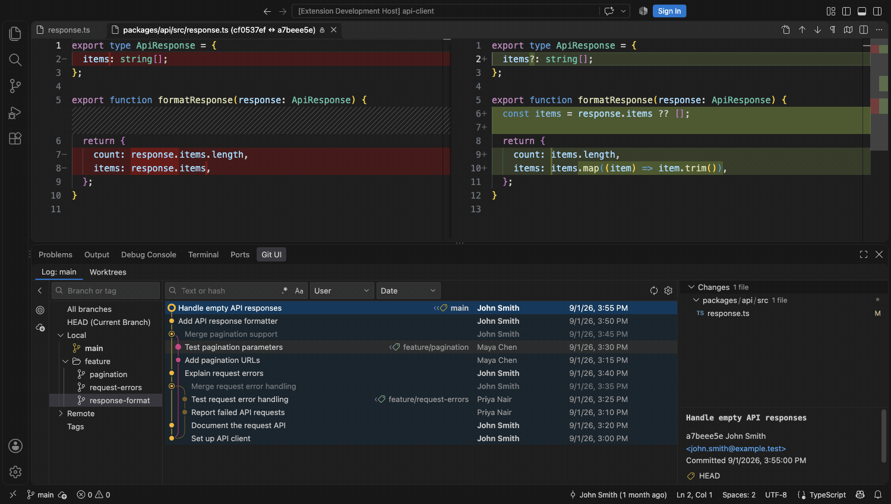
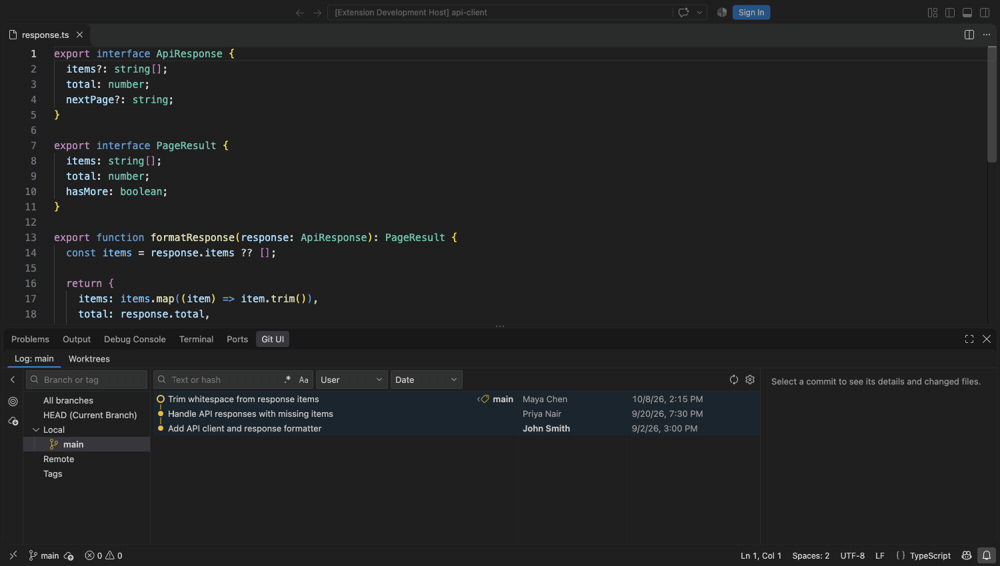
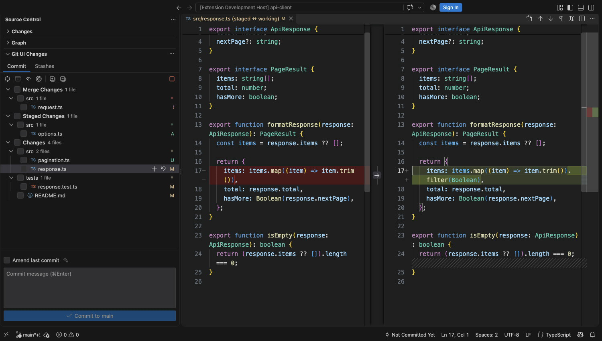
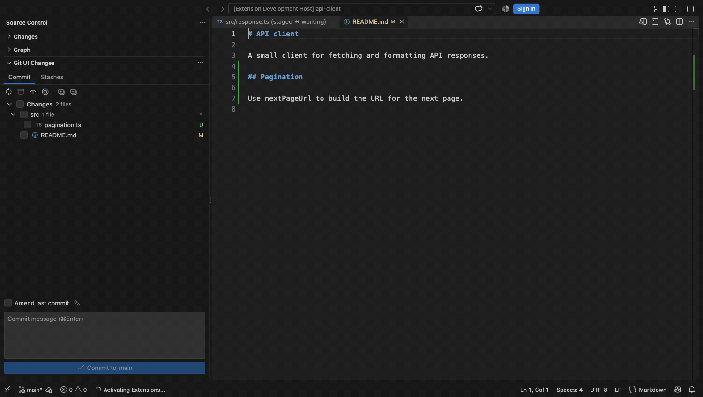

# Git UI

**Finally, a proper Git UI for VS Code. Completely free and open source. No subscriptions or paid tiers.**

Git UI helps you browse history, inspect changes, trace lines with Git Blame, commit the files you choose, and keep unfinished work in stashes. It opens comparisons in VS Code's native diff editor.

Inspired by the Git tool window in JetBrains' [IntelliJ IDEA Community Edition](https://github.com/JetBrains/intellij-community).

## Browse history and inspect changes

## Fits your VS Code theme

The panel follows your VS Code theme.

## Git Blame

Choose **Git UI: Annotate with Git Blame** from the editor's line-number menu to see who changed each line and when.

## Improved Source Control

### Stashes

Keep unfinished work in named stashes. Restore a whole stash or just the files you need.

## More ways to work with Git

- Create, check out, rename, delete, update, merge, or rebase branches. Restore an accidentally deleted branch from its notification.
- Cherry-pick commits, edit messages, squash, or drop eligible commits. Create a branch or tag from a commit.
- Create a worktree for another branch, open it in this window or a new one, and remove it when finished.

Branch, commit, and worktree lists support multiple selection. Use VS Code's Source Control and editors to resolve conflicts.

## Get started

Install Git UI and open a Git repository in VS Code. The **Git UI** tab in the bottom panel loads your branches and history automatically. In Source Control, expand **Git UI Changes** to find the **Commit** and **Stashes** tabs. You can hide the built-in Changes view if you prefer the checkbox workflow.

## Your repositories stay yours

Git UI has no account, cloud backend, or analytics service. Fetch connects to your configured Git remotes using VS Code's Git authentication. Optional commit message generation uses a language model configured in VS Code and sends only the checked changes to that provider when you request it. You can edit the draft before committing.

## Feedback and contributions

[Report a bug or suggest a feature](https://github.com/andreymyssak/vscode-git-ui/issues). To contribute, see [CONTRIBUTING.md](CONTRIBUTING.md).

For security vulnerabilities, follow the private reporting instructions in [SECURITY.md](SECURITY.md).

## License

Authored code is [MIT licensed](LICENSE.txt). Bundled Microsoft code and libraries retain their licenses in [THIRD_PARTY_NOTICES.md](THIRD_PARTY_NOTICES.md).
